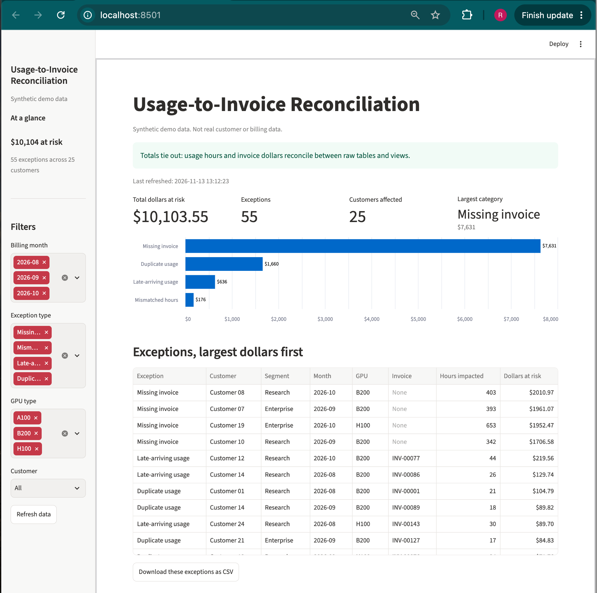
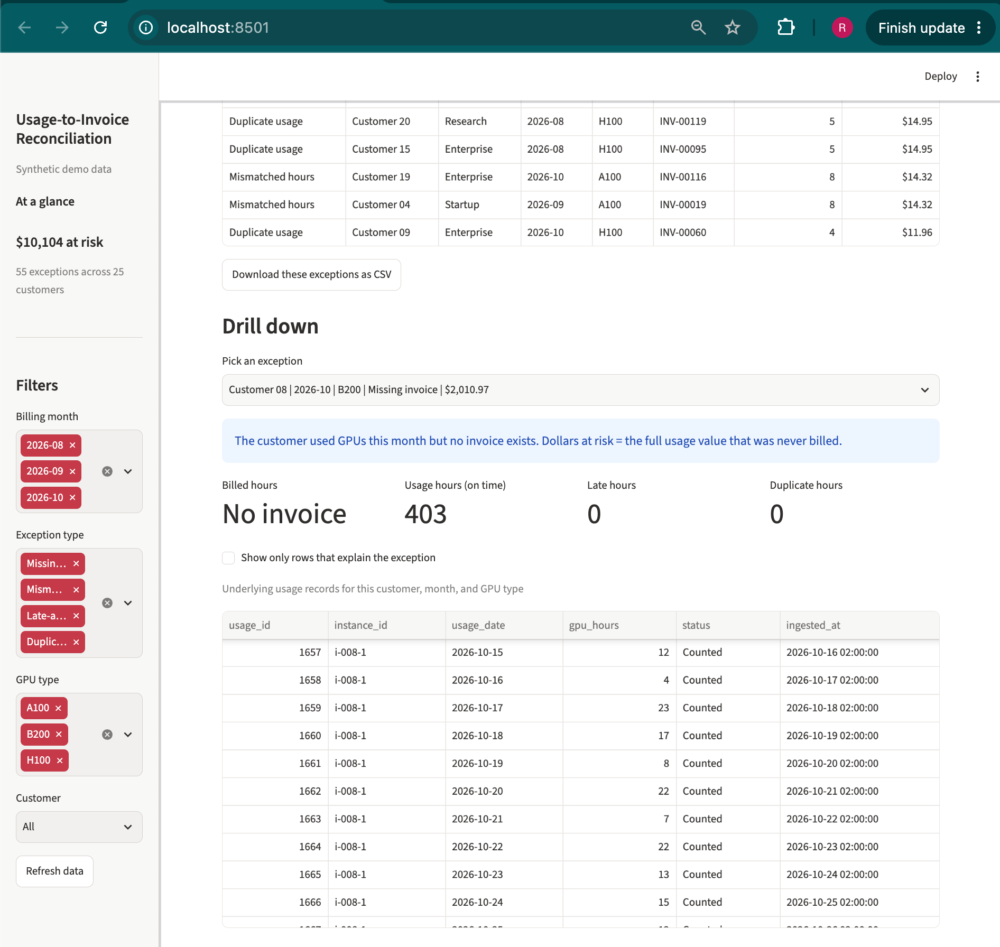
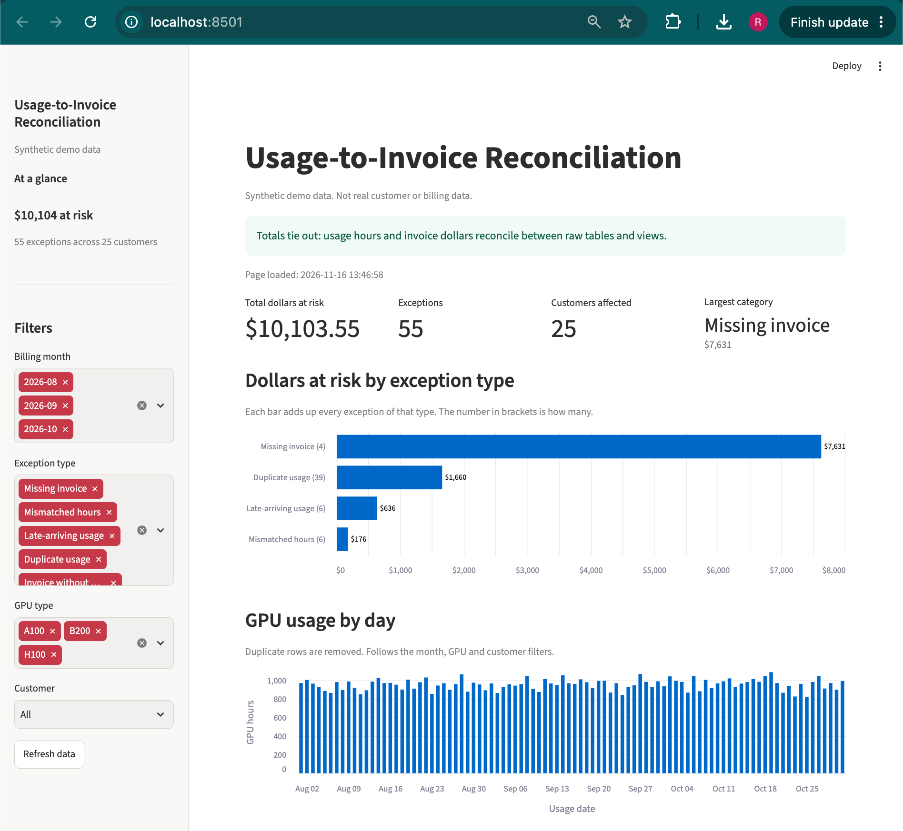
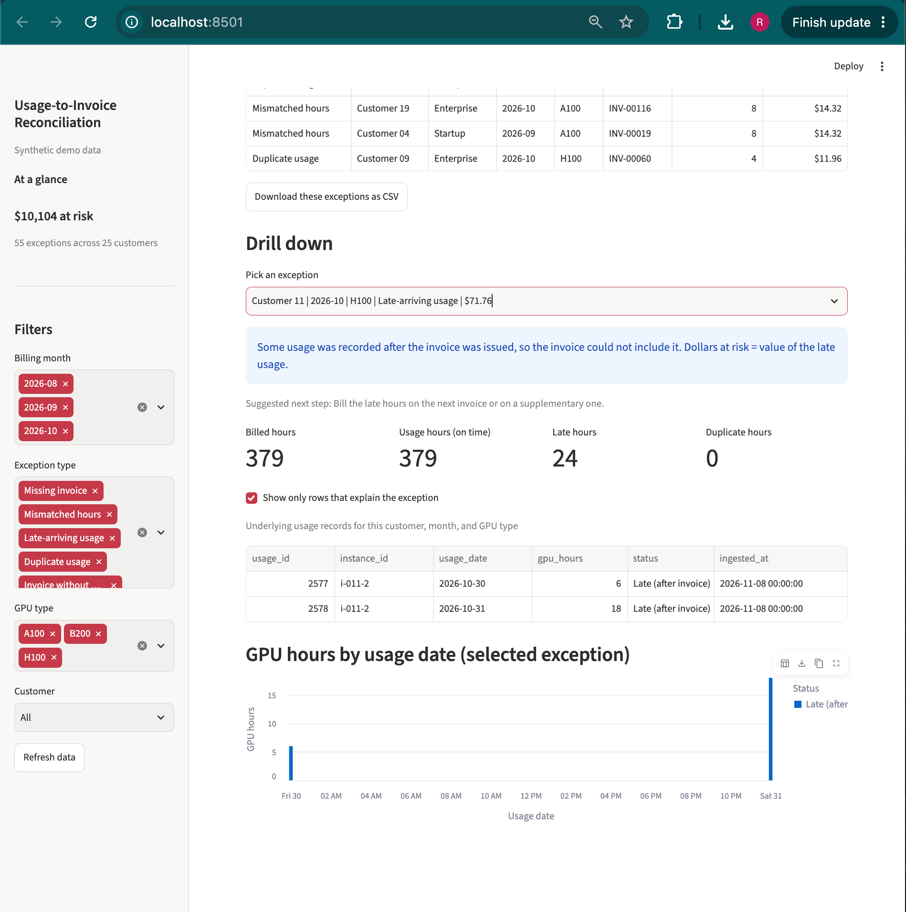

# Usage-to-Invoice Reconciliation Tool

> **All data in this project is synthetic.** I do not know any company's real billing logic, so this
> is **how I would approach the problem**, not a description of how any real company works. Names,
> rates, volumes, and errors are invented. Credentials in the repo are local demo placeholders.

## The problem
A GPU cloud business measures what customers **used** and sends invoices for what they **owe**.
When the two disagree, the business either loses revenue or overbills a customer. I assume the
comparison is done by hand in spreadsheets each month: slow, error-prone, and hard to trust.

## The user
A finance or billing-operations analyst who needs to know **which mismatches to chase first**, in
dollars, and who must be able to trace any number back to the underlying records.

## What it does
It compares usage to invoices, flags five kinds of exception, and puts a dollar amount on each:

| Exception | Meaning |
|---|---|
| Missing invoice | Usage exists for a customer, month, and GPU type, but no invoice |
| Mismatched hours | An invoice exists, but billed hours differ from usage |
| Late-arriving usage | Usage was recorded after the invoice date, so the invoice could not include it |
| Duplicate usage | The same instance-day appears more than once in the usage feed |
| Invoice without usage | An invoice exists, but there is no usage for that customer, month, and GPU type |

The synthetic generator plants the first four kinds of error and writes an answer key
(`data/planted_errors.csv`), so I can check that the tool finds exactly what was planted. The fifth
kind is covered by a test (see below).

## Screenshots





### What I changed after the first run
I reviewed the first version as a user would and changed what got in the way:

| First version | Change | Why |
|---|---|---|
| Vertical bar chart; small categories nearly invisible | Horizontal bars with dollar labels | One category dominates the scale, so labels keep the small ones readable |
| "Largest category" tile cut off ("Missing inv...") | Wraps onto two lines and shows its dollar amount | Truncated text looks broken |
| Title and total scrolled out of view | Title and "at a glance" total pinned in the sidebar | The headline number should stay visible while drilling into a row |

Earlier screenshots: [`FirstView1.png`](docs/screenshots/FirstView1.png), [`FirstView2.png`](docs/screenshots/FirstView2.png).

### What I added in the second round
| Added | Why |
|---|---|
| "GPU usage by day" chart | Shows usage over time. Duplicates are removed, and it follows the month, GPU, and customer filters |
| Chart under the drill-down table | Shows which days make up the selected exception. It uses the same rows as the table, so the two cannot disagree |
| "Suggested next step" line in the drill-down | A flag is only useful if the user knows what to do about it |
| "Invoice without usage" shown in the dashboard | It was already in the SQL and the tests, but hidden on screen |
| Tie-out banner adds back invoice-only dollars | Otherwise the banner would turn red whenever an invoice without usage exists |
| Bar chart title and counts, for example "Missing invoice (4)" | Each bar adds up many rows, while the table shows single rows. The labels avoid mixing the two up |

## Key decisions and why
- **Compare at the invoice grain.** Usage is daily and invoices are monthly, so usage is rolled up to
  customer x month x GPU type before comparing. Definitions are in [`docs/metrics.md`](docs/metrics.md).
- **Clean in layers, keep raw untouched.** Raw tables accept duplicates on purpose. Views remove
  duplicates and separate late rows, so every number can be traced back to source.
- **Logic in SQL views, not app code.** Finance, engineering, or a BI tool can read and reuse it.
- **Default to a work queue.** The dashboard opens on exceptions sorted by dollars at risk, not a
  table of everything. See [`docs/requirements.md`](docs/requirements.md).
- **Trust is visible.** A "totals tie out" badge turns red if the checks fail.
- **CSV export** because follow-up work happens in spreadsheets.
- **Plain SQL, no dbt, for version 1.** Keeps the stack small and runnable on any laptop.

## How it is built
```
src/generate_data.py  ->  data/*.csv  ->  src/load_data.py  ->  MySQL raw tables (Docker)
                                                              ->  sql/01_views.sql (4 layered views)
                                                              ->  tests/ (pytest)  +  app/dashboard.py (Streamlit)
```
MySQL 8.4 in Docker | Python 3.12 | pandas, pymysql | pytest | Streamlit

## How I verified it
- **8 pytest checks:** unique invoice grain, unique de-duplicated usage, no join fan-out, no nulls in
  exceptions, usage hours tie out, invoice dollars tie out, exceptions match the planted answer key,
  and an invoice without usage is flagged (the test inserts a temporary invoice and rolls it back).
- **Answer key:** exception counts and dollars from the views match the generator to the cent.
- **Manual check:** I traced customer 1, 2026-09, H100 by hand. Raw usage was 425 hours, the invoice
  said 440, and the view reported a 15-hour difference.
- **Dashboard check:** I compared the drill-down chart with the table for a missing-invoice case and a
  late-arriving case. The hours match.

| Planted (synthetic) | Rows | Dollars at risk |
|---|---|---|
| Missing invoice | 4 | 7,631.09 |
| Mismatched hours | 6 | 176.14 |
| Late-arriving usage | 12 | 636.06 |
| Duplicate usage | 40 | 1,660.26 |

These are properties of the made-up data, not impact claims.

## Run it
Requires Docker and Python 3.10+.
```bash
python3 -m venv .venv && source .venv/bin/activate
pip install -r requirements.txt

docker compose up -d                 # MySQL on port 3307; schema loads on first start
python src/generate_data.py          # creates synthetic CSVs (fixed seed)
python src/load_data.py              # loads raw tables
docker exec -i recon-mysql mysql -uroot -prootpw recon < sql/01_views.sql
pytest -v
streamlit run app/dashboard.py
```
The schema file only runs on a fresh volume. To reset: `docker compose down -v`, then repeat.

If the live app is unavailable, `docs/screenshots/` and `docs/exceptions_sample.csv` show the output.

## MySQL vs Snowflake notes
I wrote portable SQL and noted where the engines differ. I have not run this on Snowflake.

| Topic | MySQL (used here) | Snowflake (to verify) |
|---|---|---|
| Add a month | `DATE_ADD(x, INTERVAL 1 MONTH)` | `DATEADD('month', 1, x)` |
| Parse a date string | `STR_TO_DATE(s, '%Y-%m-%d')` | `TO_DATE(s)` |
| Constraints | Primary and foreign keys enforced | Primary, foreign, and unique keys are informational only, so uniqueness must be tested |
| Timestamps | `DATETIME` | `TIMESTAMP_NTZ` |
| Dedupe pattern | `ROW_NUMBER()` in a view | Same, or the `QUALIFY` clause |
| Full outer join | Not supported | Supported |
| Identifier case | Case rules vary | Unquoted names are uppercased |
| Loading | Python inserts | Stage + `COPY INTO` |

## Possible next step: Snowflake + dbt (plan only, not built)
I would load the same data into a RAW schema and map the views to models:

| Today | Possible dbt equivalent |
|---|---|
| `v_usage_ranked` | staging model |
| `v_usage_by_key` | intermediate model |
| `v_reconciliation`, `v_exceptions` | mart models |
| pytest checks | `not_null`, `unique`, and a custom totals-tie-out test |

I am not claiming any company uses these tools.

## Adoption plan (hypothetical)
1. **Pilot with one or two finance users** on one real monthly cycle, running the tool alongside the spreadsheet.
2. **Review flagged exceptions with them** to catch false positives before anyone relies on it.
3. **Retire the spreadsheet** for that cycle once they trust the numbers.
4. **Keep a feedback loop:** a short list of requested changes, prioritized by impact versus effort.
5. **Next feature to ask them about:** an owner and status for each exception, so the tool tracks what has been chased and what is resolved.

## Measuring impact (no numbers claimed)
| Goal | How I would measure it |
|---|---|
| Less manual work | Time log of one reconciliation cycle before and after |
| Trust | Share of flagged exceptions finance confirms as real; whether the spreadsheet is retired |
| Adoption | Weekly active viewers and CSV exports |
| Time saved | Minutes per monthly cycle |

## Assumptions and limitations
- Invoice date assumed to be the 5th of the following month; "late" is measured against it.
- One rate per GPU type. No credits, discounts, commitments, or taxes.
- Invoices with no matching usage are flagged in `v_exceptions` as `invoice_without_usage` and shown in
  the dashboard. The synthetic data contains none, so the check is covered by a test that inserts a
  temporary invoice and rolls it back.
- Exception dollars are summed per category. A key that is both late and duplicated could overlap; the synthetic data has no overlaps.
- "Page loaded" shows when the page was opened, not when the data was loaded.
- There is no owner or status on an exception yet, so the tool shows what to chase but not who is chasing it.
- Demo credentials only. A real deployment needs a secrets manager, authentication, scheduled refresh, and hosting.
- Error rates in the synthetic data are deliberately high, so every check fires.

## How I built it
I scoped the problem, defined the metrics and exception rules, chose the structure, directed the build,
and reviewed and tested the results, including the manual trace above. The code was written with an AI
coding assistant (Claude). I can explain each file and change it, but I did not write it unaided.

## Repo layout
```
README.md
docker-compose.yml  requirements.txt
data/       generated synthetic CSVs and the planted-error answer key
src/        generate_data.py, load_data.py
sql/        00_schema.sql (raw tables), 01_views.sql (reconciliation layers)
app/        dashboard.py (Streamlit)
tests/      test_data_quality.py (pytest)
docs/       metrics.md, requirements.md, screenshots/, exceptions_sample.csv
```
